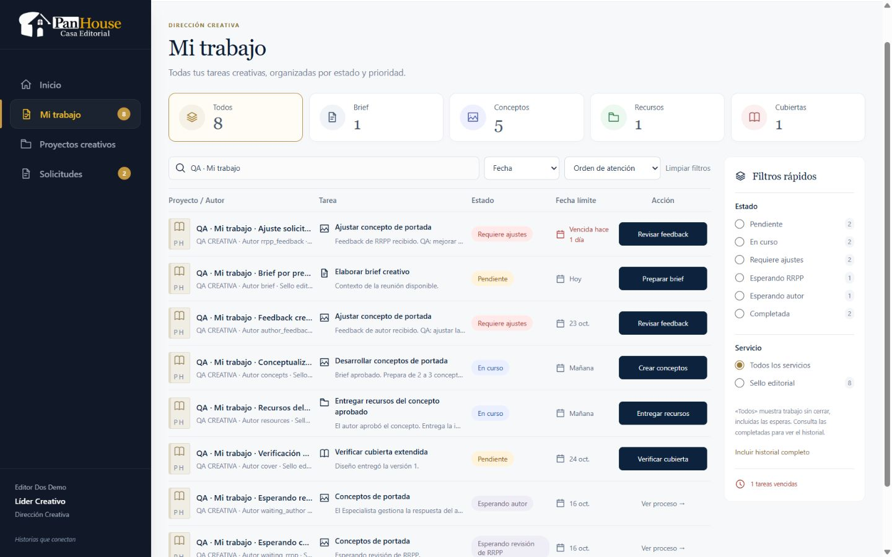

# Mi trabajo · Dirección Creativa · reporte A–AP

Fecha: 21 de octubre de 2026 (America/Caracas).

Implementación real sobre `36dbc41`, con árbol inicialmente limpio. Sin datos de la referencia en producción, sin creación manual y sin migraciones destructivas. La referencia se utilizó para composición y densidad; se conservaron logo y shell reales del rol.

| Punto | Resultado |
|---|---|
| A · Estado previo | Git limpio. Mi trabajo reutilizaba el listado de acciones de Inicio y filtraba/paginaba diez filas en React; no incluía esperas ni historial. |
| B · Modelo reutilizado | `work_items` + `direcciones_creativas` + `project_assignments` vigente por intervención. Una fila por work item; un proyecto puede repetirse. |
| C · Tipos encontrados | Work item `direccion_creativa`; procesos `concepto_portada` y `revision_cubierta`; seis acciones creativas existentes. |
| D · Tipos añadidos | Ningún tipo persistido, rol o enum de DB nuevo. DTO de consulta con grupos y estados derivados. |
| E · Servicio backend | `creativeInbox.ts`: CTE compartida, consulta parametrizada, filtros/orden/página/counts en Postgres. Una sentencia por listado. |
| F · DTO | IDs exactos, proyecto/coautores/servicio, acción y grupo separados, estado, contexto y origen del feedback, waitingOn, actionable, fecha real, timestamps y portada real si existe. Sin URL arbitraria de DB. |
| G · Filtros | Tipo arriba; estado/servicio en facetas laterales; fecha y orden en barra; alcance activo/completadas/historial. |
| H · Búsqueda | Servidor por proyecto, autor, tarea y feedback; 300 ms de debounce; `%` y `_` literales. |
| I · Paginación | SQL, 10/25/50 filas, total real, ajuste a última página si queda fuera de rango. |
| J · Sort | Vencidas accionables, hoy, ajustes, próximas, sin fecha, resto; alternativa fecha; desempate por work item. |
| K · Counts | Reales; una consulta con facetas. «Todos» respeta el scope seleccionado. Badge del sidebar cuenta acciones, no esperas. |
| L · Waiting RRPP | «Esperando revisión de RRPP», consulta secundaria, sin entrega ni overdue. Comprobado en móvil y detalle. |
| M · Waiting autor | waitingOn AUTHOR, sin formulario/CTA primaria ni overdue. Feedback devuelve acción según workflow existente. |
| N · Deadline | `fecha_fin_pautada`, helpers Caracas, Hoy/Mañana/fecha/Sin fecha pautada. |
| O · Overdue | Solo accionables con plazo real pasado. Esperas y completadas quedan fuera aunque tengan una fecha antigua. |
| P · Sidebar | Reutiliza navegación del rol con Inicio activo según vista, Mi trabajo, Proyectos creativos, Solicitudes y footer real. Ver límite de Indicadores abajo. |
| Q · Header | DIRECCIÓN CREATIVA / Mi trabajo / subtítulo solicitado. Sin Nueva solicitud ni CTA sustituta. |
| R · Categorías | Cinco accesos compactos de tipo. Los estados permanecen separados semánticamente. |
| S · Lista | Proyecto/Autor, Tarea, Estado, Fecha límite y Acción. Contexto debajo, portada real o placeholder editorial. |
| T · Rail lateral | Estados y servicios con counts; vencidas compacto; diálogo nativo en tablet/móvil. Sin filtros duplicados de servicio/estado arriba. |
| U · CTA mapping | Ruta local construida por IDs/tipo: Brief, conceptos, feedback, recursos y cubierta. Regreso conserva búsqueda/filtros/página. |
| V · Brief | Entregado desde Chrome → esperando Especialista, sin acción del Líder. Evidencia `workflow-brief.jpg`. |
| W · Concepts | Dos conceptos entregados desde Chrome → espera RRPP. Ajustes RRPP y autor entregados desde sus workspaces → espera de terceros. |
| X · Resources | Imagen + PDF entregados desde Chrome → work item completado y disponible en historial. |
| Y · Cover | Cubierta V1 abierta desde la fila; solicitud de ajustes desde Chrome → revisión del Líder completada y flujo de Diseño continúa. Aprobación cubierta cubierta por integración existente. |
| Z · Inicio | Usa la misma clasificación SQL; mantiene atención limitada a seis. No se duplica la lógica de fases/esperas en React. |
| AA · Solicitudes | Mantiene inbox de handoffs sin asignar. No se muestran como filas de Mi trabajo ni se crean solicitudes desde esta bandeja. |
| AB · Proyectos creativos | Mantiene consulta por intervención/proyecto, separada del listado de trabajo. |
| AC · RBAC | Solo `lider_creativo`; identidad de sesión. No se amplían privilegios de supervisión ni de otros roles. |
| AD · IDOR | Asignación vigente al work item exacto; reasignar revoca lectura/escritura anterior. Cubiertos concepto/proceso/proyecto y otra intervención del mismo proyecto. |
| AE · Tests nuevos | 13 pruebas backend adicionales sobre el archivo creativo (29 pruebas creativas en total), más 5 pruebas frontend de render/rutas. |
| AF · Regresión completa | `npm test`: 76 archivos aprobados; 1.440 pruebas aprobadas; 0 fallidas. Duración 467,44 s. Incluye las 29 pruebas creativas y las 5 frontend. |
| AG · Typecheck/build | Backend y frontend: typecheck y build con salida 0. Vite conserva una advertencia no bloqueante de chunks >500 kB. |
| AH · QA inicial | Chrome real con sesión existente del Líder; captura `inicial-1440.jpg`. Fixtures locales explícitos, no datos de imagen. |
| AI · Correcciones visuales | Mejorada lectura de tabla a 1440; categorías compactas; rail sin duplicados; ajuste de barra móvil y singular de vencidas. También corregido toggle de historial para conservar la URL. |
| AJ · QA 1440 | `final-1440.jpg`, ocho filas QA reales antes de ejecutar entregas. Shell real, cinco columnas, panel lateral, CTAs específicas y esperas suaves. |
| AK · Tablet | 768×1024: tabla simplificada y filtros en diálogo; scrollWidth 768, sin overflow de documento. `tablet-768.jpg`. |
| AL · Mobile | 375×812: tarjetas y diálogo de filtros; tabla oculta, scrollWidth 375. `mobile-375.jpg`, `mobile-filters.jpg` y comprobación final `mobile-final-375.jpg` con el selector «Atención» legible. |
| AM · Known gaps | Indicadores no tiene ruta creativa real en el repositorio y no se creó analítica ni enlace muerto. La tipografía/logo/cuenta siguen el shell existente. No se validan permisos remotos de enlaces Drive ni se suben archivos, conforme al flujo previo. No se realizó benchmark con 10.000 filas; sí prueba constante de una sentencia con 1/16 trabajos y paginación SQL real. |
| AN · Diff stat | Ver `git-diff-stat.txt`. |
| AO · Git status | Ver `git-status.txt`; árbol limpio tras commit. |
| AP · Commit | Commit local final de esta implementación; consultar `git log -1`. No se hizo push. |

## Fuentes revisadas

- Manual real `fuentes-negocio/Proceso de adiestramiento - Especialista editorial (3).docx`, párrafos de Brief, 2–3 conceptos, aprobación RRPP antes del autor, imagen Freepik + PDF y revisión creativa de cubierta.
- Matriz real `fuentes-negocio/DIRECCIÓN CREATIVA.xlsx`, 19 hojas, columnas de reunión, entrega/aprobación de Brief y propuestas. No se infirió prioridad ni SLA creativo de las diferencias de días.
- Arquitectura 05/12/13/27, auditoría de roles y código vigente de trabajo creativo, comandos, asignaciones, solicitudes, notificaciones/audit, gates, Diseño, Especialista y workspace Drive.
- Auditoría Git: status, diff --stat, diff y últimos 15 commits antes de modificar.

## Pruebas y recorridos

El archivo creativo cubre roles/sesión, alcance vigente y reassignment, dos work items del mismo proyecto, filtros combinados, facetas, búsqueda literal/inyección, fecha Caracas y orden, paginación y límites, estados de espera, completadas, proyecto culminado/retirado, coste constante en sentencias y empty real. Mantiene los recorridos existentes de Brief, RRPP, autor, recursos y aprobación/rechazo de cubierta.

Las pruebas frontend renderizan filas/categorías/estados/CTA, waiting sin acción primaria, paginación, vacío, vacío filtrado, loading, error con retry y rutas que preservan regreso/IDs/concepto. La interacción real en Chrome confirma búsqueda, filtros móviles, detalle específico, regreso con filtros, segunda página real, vacío filtrado recuperable e historial. `scripts/creative-inbox-verify-qa.ts` verificó en modo lectura los nueve escenarios después de operarlos: seis esperas abiertas, cuatro filas históricas (incluida la intervención fuente de cubierta), Diseño en_progreso y revisión interna anterior cancelada. Evidencia: `post-workflow-qa.json`.

La primera ejecución completa se descartó: se inició accidentalmente una segunda verificación sobre la misma base de tests y hubo interferencia de sesiones. Se detuvieron ambos procesos y se repitió la suite final en una sola ejecución secuencial. No se contabiliza esa corrida descartada como evidencia final.

Durante hot reload de desarrollo se observó un error contextual del listado; «Reintentar» recuperó los datos conservando shell y filtros. La verificación final se realiza con los procesos estables.

## Datos QA

`scripts/creative-inbox-fixture-qa.ts` solo admite `NODE_ENV=development`, host local y base `/panhouse`; reutiliza identidades y catálogos existentes. Generó nueve proyectos nuevos marcados `QA · Mi trabajo`, más el work item independiente de revisión de cubierta. No modifica proyectos previos ni llama Google. URLs sintéticas bajo `example.test`. IDs no sensibles en `qa-fixtures.json`; sesiones privadas permanecen en `secrets/`, ignorado por Git.

Las capturas desktop/tablet/móvil muestran los fixtures antes de entregarlos. Las seis acciones se ejecutaron después en la UI; por ello el estado actual de esos fixtures es espera/completada. No se reabrieron artificialmente para mantener la fotografía inicial. Las tareas normales existentes siguen obteniéndose de la base de datos.

## Evidencia visual

[Tablet](tablet-768.jpg) · [Móvil](mobile-375.jpg) · [Móvil final](mobile-final-375.jpg) · [Filtros móviles](mobile-filters.jpg) · [Vacío filtrado](empty-filter.jpg)

[Brief](workflow-brief.jpg) · [Conceptos](workflow-concepts.jpg) · [Feedback RRPP](workflow-rrpp-feedback.jpg) · [Feedback autor](workflow-author-feedback.jpg) · [Recursos](workflow-resources.jpg) · [Ajustes de cubierta](workflow-cover-adjustments.jpg)
