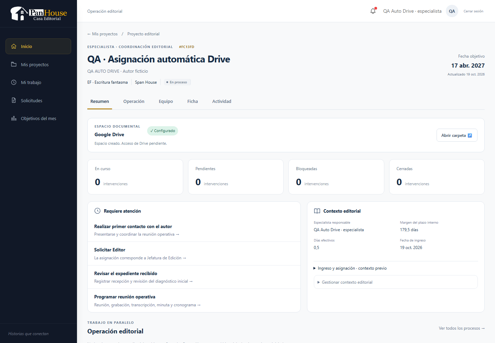
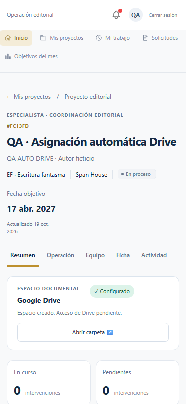

# Asignación → espacio documental automático

Validación local del 19 de octubre de 2026, base inicial `2092d3c`, repositorio inicialmente limpio. No se reconstruyeron OAuth, cifrado, integración corporativa, adapter ni templates de la fase anterior.

| Punto solicitado | Resultado |
|---|---|
| A. Flujo anterior | El Especialista iniciaba una operación síncrona con «Crear espacio de trabajo». |
| B. Flujo nuevo | Jefatura asigna → transacción confirma negocio e intención → enqueue post-commit → BullMQ provisiona → PostgreSQL READY → UI actualiza automáticamente. |
| C. Evento de assignment | `ESPECIALISTA_ASIGNADO` / `ESPECIALISTA_REASIGNADO`; la intención única se inserta desde `asignarConHistorial`, solo para el scope de proyecto/Especialista. `asignarEspecialista` y Equipo despachan después del commit. |
| D. BullMQ | Queue `project-drive-workspaces`; job `provision-project-drive-workspace`; payload solo `projectId`; cuatro intentos con backoff exponencial. |
| E. Business key / idempotencia | `project-drive-workspace-<projectId>`; solicitud única, workspace único, lock por proyecto, lock corporativo e IDs Drive reservados/persistidos antes de create. Reintentar un job retenido usa `retry(state)`. |
| F. Lifecycle | Solicitud PENDING/PROVISIONING/READY/ERROR; workspace mantiene PROVISIONING/READY/ERROR. El DTO refleja error de configuración aunque aún no exista workspace físico. |
| G. Google caído | Assignment conserva éxito. Error independiente del workspace, audit y aviso interno al owner. Redis caído también conserva intención para recuperación. |
| H. Templates | Se reutiliza resolución backend por servicio, autor/coautores, condiciones canónicas y subtipo Crudo. El plan/versión de un workspace existente no cambia en retries. |
| I. Crudo | Sin subtipo: ERROR, razón humana, audit y aviso a Jefatura para coordinar la definición con RRPP. El Especialista no puede inventarlo ni resolverlo con un retry. |
| J. Operación | Preparación inicial conserva contacto, expediente, reunión y documentos humanos. Espacio documental se completa automáticamente; modal muestra únicamente folders persistidos/verificados. |
| K. Resumen | Utilidad compacta con Google Drive, estado y «Abrir carpeta». |
| L. Quick link | El acceso secundario del Resumen es el acceso rápido. Se conserva la jerarquía de las acciones del workflow; no se agregó otro CTA al header. |
| M. Ficha | Acceso de solo consulta al mismo workspace y URL, tanto en Command Center como en Ficha de Dirección/RRPP. Ninguna URL duplicada editable. |
| N. Jefatura | Lectura y enlace; no crea/reintenta ni administra normalmente la estructura. |
| O. Legacy | Asignación vigente sin solicitud y sin workspace, sin heurística temporal. Ofrece «Configurar espacio»; ningún barrido de proyectos al arrancar. |
| P. Retry | Solo ERROR recuperable o legacy para Especialista; Dirección dispone del recovery administrativo. HTTP 202, asincrónico, conserva raíz, IDs y avances. |
| Q. Reasignación | Conserva workspace y rootFolderId; el anterior Especialista pierde lectura PanHouse y el nuevo ve el mismo espacio. Sin política de revocación Drive inventada. |
| R. Sharing | `PENDING_VALIDATION`. Adapter preparado; no se ejecutó `permissions.create`, no se ampliaron scopes, no hubo OAuth individual. |
| S. RBAC | Especialista actual, Jefatura y RRPP según acceso existente; Dirección para recuperación administrativa. IDOR y cuerpos arbitrarios rechazados. |
| T. Tests nuevos | Assignment sin esperar proveedor, outbox, Google caído, parcial/retry HTTP, duplicate event/job, reasignación, error administrativo/Crudo, legacy, rollback/handoff inválido, retry automático y endpoint de Jefatura. Seis tests específicos de business key/BullMQ retenido. |
| U. Regresión total | **1.406 pruebas aprobadas en 74 archivos**, sin fallos, en 478 segundos. Resultado en `validation.json`. La primera pasada detectó dos límites SQL; se consolidó a una consulta por lote y también pasaron las 79 pruebas focalizadas posteriores. |
| V. Builds | Backend TypeScript y frontend TypeScript/Vite aprobados. Vite mantiene el aviso por bundles mayores de 500 kB. |
| W. QA desktop | Asignación real desde Jefatura, login Especialista, Resumen, Ficha, Preparación, árbol, nueva pestaña Drive y Jefatura READY de solo consulta. 15 checks reales, cero errores JS. |
| X. Mobile | 375×812 y tablet 768×1024: enlace visible y sin overflow. Estados de error y legacy incluidos. 16 checks de estados UI, cero errores JS. |
| Y. Asignación QA real | Proyecto `FC13FD`, sin workspace previo. Asignación UI respondió 200 en 120 ms. Evento RRPP → Jefatura y assignment auditados; job real completado aproximadamente 38 s después. |
| Z. webViewLink | [Abrir workspace QA](https://drive.google.com/drive/folders/1YDK6tKTDgSpFcAWuQNq2mfRA9rx9i5rl). Se conserva para validación humana. |
| AA. Expected vs actual | EF + Ilustraciones/Gráficos: 30 esperadas, 30 persistidas, 30 verificadas y 30 enumeradas realmente en Drive; missing=0, unexpected=0. |
| AB. Known gaps | Sharing pendiente de correo corporativo/validación real y política de concesión/revocación al reasignar. El navegador QA sin sesión Google llega al login de Google; la carpeta se verificó además con la integración corporativa real. No se creó ningún permiso para simular acceso. |
| AC. git diff --stat | Ver `git-diff-stat.txt`, capturado antes del commit. El snapshot Drizzle generado explica la mayor parte de las líneas nuevas. |
| AD. git status | Ver `git-status-before.txt`; se verificó árbol limpio tras el commit. |
| AE. Commit | Commit local de implementación y evidencias; hash comunicado en la entrega final. No se hizo push. |

## Identificadores para revisión humana

| Campo | Valor |
|---|---|
| projectId | `7b63bafa-2361-4294-b59b-33e2a46e2430` |
| workspaceId | `f33e5965-4169-4e92-9728-0ac543b3407a` |
| rootFolderId | `1YDK6tKTDgSpFcAWuQNq2mfRA9rx9i5rl` |
| Raíz administrativa | `PANHOUSE - PROYECTOS EDITORIALES - DEV` |
| Template | `EF`, `specialist-manual-2026-v1` |
| Carpetas | 1 raíz + 29 subcarpetas |

El inventario completo con nombre, padre, key, ID, URL y verificación está en [real-drive-verification.json](real-drive-verification.json). Los eventos prueban la secuencia RRPP → Jefatura → assignment → inicio automático → READY. Las credenciales QA solo están en `secrets/`, ignorado por Git.

## Autoauditoría

Los 18 puntos solicitados se comprobaron: auto provisioning al asignar; assignment independiente; BullMQ; deduplicación; identidad al reasignar; sin cuenta hardcodeada; enlace para Especialista; URL única de Ficha; sin creación manual normal; retry acotado; sin Google por render; fallo independiente; templates por servicio; Crudo bloqueado; scope conservado; sin OAuth individual; sharing no bloqueante y QA iniciado desde Jefatura. La validación de compartir sigue explícitamente pendiente, conforme a la condición del producto.

